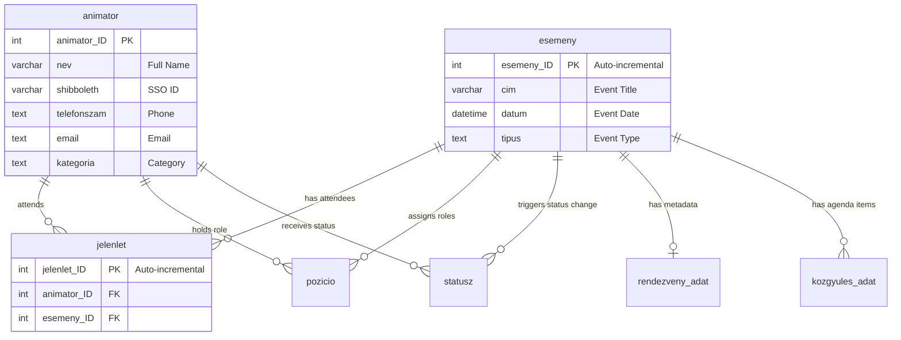

# Animator Administration System - Design Document

## 1. Project Overview & Objectives

This project is an administrative web interface designed for managing animators, events, and attendance records. Currently, event creation and attendance tracking are managed manually via a Google Spreadsheet that generates SQL `INSERT` statements for manual execution in the database.

### 1.1 Core Objectives
- **Modern Web & PWA Interface**: Mobile-friendly, installable progressive web app (PWA) allowing administrators to manage events and record attendance on phones, tablets, or laptops.
- **Replace Google Sheets Workflow**: Provide an intuitive, modern UI for creating events and registering animator attendances directly.
- **Automated Sequential ID Handling**:
  - Automatically determine and increment `esemeny_ID` when creating new events.
  - Automatically determine and increment `jelenlet_ID` when recording individual or batch attendances.
- **Batch Attendance Registration**: Enable fast selection of multiple animators for a single event without typing IDs or generating queries manually.
- **Data Integrity & Validation**: Prevent duplicate attendance records, invalid foreign keys, and manual SQL syntax errors.
- **Seamless Integration with Existing MySQL Database**: Maintain 100% compatibility with the existing private MySQL/MariaDB database (`anim_uj` schema) accessible via phpMyAdmin.

---

## 2. Current Workflow & Pain Points

### 2.1 The Google Sheets Workflow
Currently, event management and attendance logging are performed in a spreadsheet:
1. **Event Registration**:
   - The user enters the event name (*Esemény neve*, e.g., `Pázmány nap`), date (*Dátum*, e.g., `2026-10-14`), and selects the event type (*Típus*, e.g., `tréning` or `egyetemi rendezvény`).
   - The next `esemeny_ID` (e.g., `762`) is calculated/entered.
   - The sheet builds an SQL string via formula:
     ```sql
     INSERT INTO `esemeny` (`esemeny_ID`, `cim`, `datum`, `tipus`) 
     VALUES (762, 'Pázmány nap', '2026-10-14', 'egyetemi rendezvény');
     ```
2. **Attendance (Jelenlét) Registration**:
   - For every attending animator, a row is selected with the animator's name (*Név*, e.g., `Bolla Péter`, `Széwald Péter Tamás`).
   - The sheet looks up `animator_ID` (e.g., `883`, `963`).
   - Consecutive `jelenlet_ID`s (e.g., `17630`, `17631`, continuing from the last ID `17629`) are generated.
   - The sheet generates SQL insert statements:
     ```sql
     INSERT INTO `jelenlet` (`jelenlet_ID`, `animator_ID`, `esemeny_ID`) 
     VALUES (17630, 883, 762);
     ```
   - A checkbox confirms that queries were copied and executed in the database.

### 2.2 Pain Points
- **Manual Execution Risk**: Requires copying raw SQL queries and running them directly against the database in phpMyAdmin.
- **Concurrency & ID Collisions**: If multiple administrators work simultaneously, hardcoded or calculated IDs can collide.
- **Slow & Error-Prone**: Manually picking names in spreadsheet dropdowns and managing ID offsets is inefficient for events with dozens of attendees.
- **Lack of Immediate Verification**: No real-time feedback on whether foreign keys exist or if an animator was already registered for the same event.

---

## 3. Technology Stack & Software Architecture

The application is structured as a feature-modular, installable web application (PWA) with a three-layer architecture on the frontend, communicating with a backend API connected to the private MySQL database.

```text
+-----------------------------------------------------------------------------------+
|                            FRONTEND (PWA - React 19)                              |
|  - Phone / Tablet / Desktop responsive interface                                  |
|  - Installable to home screen (PWA, custom icon, fullscreen standalone mode)      |
|                                                                                   |
|  +------------------+    +-----------------------+    +------------------------+  |
|  |     Felület      | -> |      Szolgáltatás     | -> |         Modell         |  |
|  |  (UI Components) |    |    (Service Layer)    |    |  (Data / Validations)  |  |
|  |  EventPanel.jsx  |    |    eventService.js    |    |     eventModels.js     |  |
|  +------------------+    +-----------------------+    +------------------------+  |
+------------------------------------------|----------------------------------------+
                                           | HTTP / REST (Protected API)
+------------------------------------------v----------------------------------------+
|                                BACKEND API SERVICE                                |
|  - Node.js (Express) or PHP REST API running on the private server                |
|  - Transaction management (START TRANSACTION, COMMIT)                             |
|  - Authentication & permission validation                                         |
+------------------------------------------|----------------------------------------+
                                           | MySQL Protocol
+------------------------------------------v----------------------------------------+
|                        HOSTED PRIVATE DATABASE (MySQL)                            |
|  - MySQL / MariaDB Server (administered via phpMyAdmin)                           |
|  - Database: `anim_uj` (`esemeny`, `jelenlet`, `animator`, `statusz`, etc.)       |
+-----------------------------------------------------------------------------------+
```

### 3.1 Frontend Technology Stack
- **React 19**: Component-based UI built from reusable building blocks (*újrahasznosítható építőkockák, komponensek*). Leverages modern React hooks and actions for state management.
- **Vite**: Ultra-fast development server with hot module replacement (HMR) and optimized production bundle compilation.
- **React Router**: Client-side declarative routing supporting distinct views:
  - Events Overview / Dashboard (`/events`)
  - Event Creation & Attendance Tracker (`/events/new`, `/events/:id/attendance`)
  - Animator Directory & Profiles (`/animators`)
  - Admin & Settings (`/admin`)
- **PWA (Progressive Web App)**:
  - Installable directly to phone or tablet home screens (*kezdőképernyőre telepíthető saját ikonnal*).
  - Runs in standalone fullscreen mode without browser navigation chrome.
  - Manifest and service worker support for asset caching, quick startup, and resilient connectivity.
- **Cross-Device Responsive Design**:
  - Unified codebase running seamlessly across smartphones, tablets, and desktop/laptop browsers.
  - Touch-optimized controls for mobile attendance check-ins during on-site university events.

### 3.2 Three-Layer Feature Module Pattern (*Egy funkciómodul három rétege*)
Every functional module follows a strict separation of concerns into three distinct layers:

1. **Felület (UI Layer)**:
   - *Example*: `EventForm.jsx`, `AttendanceChecklist.jsx`, `EventListTable.jsx`
   - *Responsibility*: Renders UI elements, handles user interactions, receives form inputs, and dispatches calls to the Service layer on button clicks or form submissions.
2. **Szolgáltatás (Service Layer)**:
   - *Example*: `eventService.js`, `jelenletService.js`, `animatorService.js`
   - *Responsibility*: Encapsulates API communication. Sends network requests to read from and write to the database via the backend API. Handles HTTP responses, error states, and token management.
3. **Modell (Model / Business Logic Layer)**:
   - *Example*: `eventModels.js`, `jelenletModels.js`, `animatorModels.js`
   - *Responsibility*: Data structure definitions, sanitization, validation rules, input payload preparation, and calculation logic (e.g. attendee counts, ID increment anticipation, duplicate attendance checks).

### 3.3 Backend & Database Architecture
- **Private Server Hosting**: The database is hosted on a private server accessible via **phpMyAdmin** (identifying it as **MySQL / MariaDB**).
- **Database Schema**: Existing relational database `anim_uj` (schema detailed in Section 4).
- **Backend API Bridge**:
  - Client-side React applications cannot connect directly to MySQL port 3306 for security and protocol reasons.
  - A lightweight backend REST API service (Node.js/Express or PHP PDO API) hosted on the same server environment acts as the secure intermediary.
  - It receives authenticated requests from `szolgáltatás` (service) modules, executes transactional queries on MySQL, and returns JSON payloads.

---

## 4. Database Architecture & Schema Specification

The application operates directly on the existing `anim_uj` relational database schema hosted on the private MySQL server.

### 4.1 Core Entity Definitions

#### Table: `esemeny` (Events)
Stores all university events, meetings, trainings, and general assemblies.
| Field | Type | Attributes | Description |
|---|---|---|---|
| `esemeny_ID` | `int(11)` | PRIMARY KEY, AUTO_INCREMENT | Unique identifier for each event |
| `cim` | `varchar(100)` | NOT NULL | Title / name of the event |
| `datum` | `datetime` | NOT NULL | Date and time when the event takes place |
| `tipus` | `text` | NOT NULL | Category / type of event (see list below) |

#### Predefined Event Types (`tipus` enum values):
The dropdown for `tipus` strictly supports the following 7 standard event types:
1. `egyetemi rendezvény` (University event)
2. `nagyrendezvény` (Major event)
3. `egyéb` (Other)
4. `státuszújítás` (Status renewal)
5. `tisztújítás` (Election of officers / Renewal)
6. `közgyűlés` (General assembly)
7. `tréning` (Training)

#### Table: `animator` (Animators)
Directory of all animators.
| Field | Type | Attributes | Description |
|---|---|---|---|
| `animator_ID` | `int(11)` | PRIMARY KEY | Unique ID of the animator |
| `nev` | `varchar(100)` | NOT NULL | Full name of the animator |
| `shibboleth` | `varchar(100)` | UNIQUE | University SSO identifier |
| `telefonszam` | `text` | NULLABLE | Phone contact number |
| `email` | `text` | NULLABLE | Email address |
| `kategoria` | `text` | NULLABLE | Category (e.g., senior, junior, candidate) |

#### Table: `jelenlet` (Attendance Junction)
Connects animators to events they attended.
| Field | Type | Attributes | Description |
|---|---|---|---|
| `jelenlet_ID` | `int(11)` | PRIMARY KEY, AUTO_INCREMENT | Unique attendance record ID |
| `animator_ID` | `int(11)` | FOREIGN KEY (`animator.animator_ID`) | ID of the attending animator |
| `esemeny_ID` | `int(11)` | FOREIGN KEY (`esemeny.esemeny_ID`) | ID of the event attended |

### 4.2 Related Tables & Extended Context
- **`pozicio`**: Specific roles assigned to animators during an event (`pozicio_ID`, `animator_ID`, `esemeny_ID`, `pozicio`).
- **`statusz`**: Animator status records tied to an event (`statusz_ID`, `animator_ID`, `esemeny_id`, `statusz`).
- **`rendezveny_adat`**: Extra event details (`leiras`, `gcal_id`, `promo_kepek`, `kepek_link`, `ajanlott_letszam`).
- **`kozgyules_adat`**: Agenda and minutes if the event is a general assembly (`közgyűlés`).
- **`current_statuses`**: View summarizing the active status and category of each animator based on latest events.

### 4.3 Entity Relationship Diagram



---

## 5. Functional Specifications & System Requirements

### 5.1 Automatic ID Increment Logic
1. **Event ID (`esemeny_ID`)**:
   - The database table `esemeny` uses `AUTO_INCREMENT` on `esemeny_ID`.
   - When opening the "Create Event" screen, the system fetches the next upcoming ID (`SELECT COALESCE(MAX(esemeny_ID), 0) + 1 FROM esemeny`) via `eventService.js` and displays it in the `Felület` layer as a read-only preview (e.g., `#763`).
   - When saving, the backend commits the record, and MySQL assigns the sequential ID automatically.
2. **Attendance ID (`jelenlet_ID`)**:
   - The table `jelenlet` uses `AUTO_INCREMENT` on `jelenlet_ID`.
   - When registering attendances for an event, consecutive IDs are assigned automatically by MySQL.
   - For batch attendance creation, the system inserts multiple rows in a single transactional query (`INSERT INTO jelenlet (animator_ID, esemeny_ID) VALUES (?, ?), (?, ?)...`).

### 5.2 Event Management Workflow
1. **Create Event Form (`Felület: EventForm.jsx`)**:
   - **Event Name (`cim`)**: Text input (e.g., `Pázmány nap`).
   - **Date (`datum`)**: Date & Time picker (defaults to today's date).
   - **Type (`tipus`)**: Pre-populated select dropdown containing the 7 standard types:
     - `egyetemi rendezvény`
     - `nagyrendezvény`
     - `egyéb`
     - `státuszújítás`
     - `tisztújítás`
     - `közgyűlés`
     - `tréning`
   - **Upcoming ID Preview**: Displays next `esemeny_ID`.
   - **Action**: "Save Event" or "Save & Add Attendances".

2. **Attendance Logging (`Felület: AttendanceManager.jsx`)**:
   - Admins can log attendance either right after creating an event or by browsing to an existing event.
   - **Fast Animator Selection**:
     - **Search & Multi-Select**: Autocomplete search bar by name. Typing "Bolla" immediately suggests `Bolla Péter (ID: 883)` and adds them to the attendee list.
     - **Quick Checklist / Bulk Selector**: A filterable list of all active animators grouped by `kategoria`. Admins can quickly check off attendees.
     - **Spreadsheet / Bulk Paste Input**: An optional quick-paste input area where names can be pasted from external attendance lists or spreadsheets. `jelenletModels.js` matches names against `animator.nev` and highlights unmatched entries for review.
   - **Duplicate Detection**: The model layer checks that an animator is not recorded twice for the same event (`UNIQUE(esemeny_ID, animator_ID)` check).
   - **Submission & Confirmation**: Displays total count of attendees and atomically commits all `jelenlet` records in a single database transaction via `jelenletService.js`.

---

## 6. UI/UX Screen Designs

### 6.1 Event List & Dashboard (Responsive: Mobile / Tablet / Desktop)
- **Header**: Search filter (by title, date range, event type) and a prominent **"+ Új esemény" (Create Event)** button.
- **Table / Card Columns**:
  - `ID`: (`esemeny_ID`, e.g., `762`)
  - `Esemény neve`: (`cim`, e.g., `Pázmány nap`)
  - `Dátum`: (`datum`, formatted `YYYY-MM-DD`)
  - `Típus`: Badge with color coding depending on type (e.g., blue for `egyetemi rendezvény`, purple for `közgyűlés`, orange for `tréning`)
  - `Résztvevők`: Number of recorded attendances (`COUNT(jelenlet_ID)`)
  - `Műveletek`: "Jelenlét szerkesztése" (Edit Attendance), "Módosítás" (Edit), "Törlés" (Delete).

### 6.2 Event Creation & Attendance Modal
A streamlined two-step or unified card view optimized for touchscreens and desktop:

```text
+--------------------------------------------------------------------------+
|  Új Esemény Létrehozása & Jelenlét Rögzítés                              |
+--------------------------------------------------------------------------+
|  Következő Esemény ID: #763                                              |
|                                                                          |
|  Esemény Neve*:  [ Pázmány nap                              ]            |
|  Dátum*:         [ 2026-10-14                              ] [ Calendar ]|
|  Típus*:         [ egyetemi rendezvény                   v ]            |
+--------------------------------------------------------------------------+
|  Jelenléti Ív (Résztvevő Animátorok)                                     |
|                                                                          |
|  Keresés / Hozzáadás: [ Keress névre (pl. Bolla Péter)...   ] [+ Hozzáad]|
|                                                                          |
|  Kiválasztott animátorok (2 fő):                                         |
|  [x] #883 - Bolla Péter          (jelenlét_ID: #17630)         [ Eltávolít]|
|  [x] #963 - Széwald Péter Tamás  (jelenlét_ID: #17631)         [ Eltávolít]|
|                                                                          |
|  [ Gyors kijelölés listából ]   [ Névsor beillesztése vágólapról ]       |
+--------------------------------------------------------------------------+
|                                      [ Mégse ]  [ Esemény & Jelenlét Mentése ]|
+--------------------------------------------------------------------------+
```

---

## 7. API Architecture & Data Flow

### 7.1 Endpoints
- `GET /api/events` - Fetch events with sorting, filtering, and attendee counts.
- `GET /api/events/next-id` - Returns the upcoming `esemeny_ID`.
- `POST /api/events` - Create a new event.
  - Body: `{ cim: string, datum: string, tipus: string }`
  - Returns: `{ esemeny_ID: number, message: string }`
- `GET /api/animators` - Retrieve list of all animators for autocomplete search `{ animator_ID, nev, kategoria }`.
- `GET /api/events/:esemeny_ID/attendances` - Fetch all recorded attendees for a specific event.
- `POST /api/events/:esemeny_ID/attendances` - Batch record attendances for an event.
  - Body: `{ animator_ids: number[] }`
  - Logic: Inserts into `jelenlet` within a transaction, returns created `jelenlet_ID`s.
- `DELETE /api/attendances/:jelenlet_ID` - Remove an attendance record.

### 7.2 Transactional Safety on MySQL Server
When saving an event along with attendances:
1. `START TRANSACTION;`
2. Insert event into `esemeny` if it is new. Obtain the generated `esemeny_ID`.
3. Check for existing attendances to prevent duplicates.
4. Execute batch insert into `jelenlet`:
   ```sql
   INSERT INTO `jelenlet` (`animator_ID`, `esemeny_ID`) VALUES
   (883, 762),
   (963, 762);
   ```
5. `COMMIT;`

---

## 8. Migration & Rollout Strategy

1. **Phase 1: Database & API Setup**:
   - Verify table schemas, `AUTO_INCREMENT` flags, and foreign keys on the private MySQL server via phpMyAdmin.
   - Implement the backend REST API endpoints connecting to MySQL.
2. **Phase 2: Frontend Implementation (React 19 + Vite + PWA)**:
   - Scaffold the Vite + React 19 project with React Router.
   - Implement the 3-layer modular structure (`Felület`, `Szolgáltatás`, `Modell`).
   - Configure PWA manifest and icons for mobile installation.
3. **Phase 3: Side-by-side Testing**:
   - Run parallel with the existing Google Sheets workflow for upcoming events to verify ID continuity and data consistency.
4. **Phase 4: Full Cutover**:
   - Transition all administrators to the PWA application; retire spreadsheet-based SQL query generation.

---

## 9. AI Agent Step-by-Step MVP Implementation Guide

> **Agent Instruction**: Follow these steps strictly in sequence. Complete one step, verify its **Checkpoint**, and only then proceed to the next step. Do not try to implement everything in a single turn.

### 9.1 Core Architectural Principles
1. **Dual-Mode Data Layer (Mock / Live)**: Because the MySQL database is hosted on a private server, implement a mock data fallback (`VITE_USE_MOCK=true`) pre-populated with sample animators (`Bolla Péter`, `Széwald Péter Tamás`, etc.) and last IDs (`esemeny_ID: 762`, `jelenlet_ID: 17629`). This allows you to verify the entire UI and business logic immediately, even before live DB credentials are provided.
2. **Strict 3-Layer Separation**:
   - `Felület` (`.jsx`): Only renders JSX, handles UI state, calls Service methods. Never executes `fetch` or SQL queries directly.
   - `Szolgáltatás` (`Service.js`): Responsible for network requests (or delegating to Mock Service) and returning Promises.
   - `Modell` (`Models.js`): Holds constants, validation functions, type definitions, and pure calculation helpers.
3. **Single Responsibility**: Do not touch unrelated features (e.g., general assembly voting or promo pictures) until the core event creation + attendance recording MVP is 100% functional.

### 9.2 Mandatory Coding Style & Engineering Rules (per CLAUDE.md)
The AI agent must strictly follow the behavioral and coding rules defined in [CLAUDE.md](file:///d:/animator-adminisztacio/CLAUDE.md):

1. **Think Before Coding**:
   - State assumptions explicitly before starting any step.
   - If MySQL connection credentials, server URLs, or environment settings are not yet provided by the user, **do NOT guess** or attempt to connect to arbitrary hosts. Explicitly fall back to the mock data mode (`VITE_USE_MOCK=true`) and ask/confirm before touching production endpoints.
   - If a simpler approach exists, choose the simpler approach.

2. **Simplicity First (Minimum Code That Solves the Problem)**:
   - **No Speculative Code**: Write only the minimum code needed to satisfy the current step.
   - **No Complex State Management Libraries**: Do NOT introduce Redux, Zustand, MobX, or complicated context wrappers. Clean React state (`useState`, `useCallback`) and direct Service calls are all that is required.
   - **No Premature Abstractions**: Do not build generic multi-entity form engines or dynamic query builders for code used in only one place.
   - **Concise Implementations**: "If you write 200 lines and it could be 50, rewrite it." Keep components and functions focused.

3. **Surgical Changes**:
   - Touch only what is necessary to accomplish the step.
   - Do not "improve" or refactor unrelated files, styling, or existing configuration.
   - Remove any unused imports, variables, or functions that your changes make obsolete. Leave zero orphan code.
   - Match existing naming and structure throughout.

4. **Goal-Driven Execution**:
   - Transform every step into a verifiable loop: `[Step] -> verify: [checkpoint]`.
   - Never proceed to Step N+1 until Step N has passed its verification checkpoint.

---

### Step 1: Project Scaffolding & Directory Structure
- **Objective**: Initialize a clean Vite project with React 19, React Router, and the 3-layer modular directory structure.
- **CLAUDE.md Rule**: *Simplicity First — install only the exact required dependencies. No extra UI libraries.*
- **Commands**:
  ```bash
  npm create vite@latest . -- --template react
  npm install react-router-dom vite-plugin-pwa lucide-react
  ```
- **Files to create/structure**:
  ```text
  src/
  ├── assets/
  ├── common/
  │   ├── components/         # Shared UI: Button, Input, Modal, Badge
  │   ├── styles/             # index.css (tokens, typography, variables)
  │   └── api/                # apiClient.js (HTTP / Mock switcher)
  ├── modules/
  │   ├── events/
  │   │   ├── felulet/        # EventList.jsx, EventFormModal.jsx
  │   │   ├── szolgaltatas/   # eventService.js
  │   │   └── modell/         # eventModels.js
  │   ├── jelenlet/
  │   │   ├── felulet/        # AttendanceManager.jsx, QuickChecklist.jsx
  │   │   ├── szolgaltatas/   # jelenletService.js
  │   │   └── modell/         # jelenletModels.js
  │   └── animators/
  │       ├── felulet/        # AnimatorPicker.jsx
  │       ├── szolgaltatas/   # animatorService.js
  │       └── modell/         # animatorModels.js
  ├── App.jsx
  └── main.jsx
  ```
- **Agent Guardrail**: *Do not write UI components yet. Only set up the skeleton, router baseline, and verify the dev server starts (`npm run dev`).*
- **Checkpoint**: `npm run dev` starts without errors, displaying a placeholder homepage with React Router mounted.

---

### Step 2: Design System & Responsive Mobile-First CSS
- **Objective**: Establish styling, colors, and layout tokens before building components so the app feels polished and native on both mobile phones and desktop.
- **CLAUDE.md Rule**: *Simplicity First — use vanilla CSS custom properties without CSS-in-JS or Tailwind unless requested.*
- **Files to modify**:
  - `src/common/styles/index.css`
- **Specifications**:
  - Define color tokens for the 7 event types:
    - `egyetemi rendezvény` (Blue / Cyan)
    - `nagyrendezvény` (Purple / Indigo)
    - `egyéb` (Neutral Slate)
    - `státuszújítás` (Amber / Orange)
    - `tisztújítás` (Teal / Emerald)
    - `közgyűlés` (Rose / Crimson)
    - `tréning` (Green / Lime)
  - Mobile-first layout container with responsive max-width (`1200px` on desktop, `100%` on mobile with padding).
  - Tap target heights (minimum `44px` on interactive elements for mobile touch friendliness).
- **Agent Guardrail**: *Keep CSS vanilla and utility-scoped. Do not install heavy component libraries that add bloat.*
- **Checkpoint**: CSS compiles, theme variables are defined, and basic typography renders cleanly.

---

### Step 3: Model Layer Implementation (`Modell`)
- **Objective**: Implement pure data structures, validation rules, and ID calculation helpers with zero UI or network dependencies.
- **CLAUDE.md Rule**: *Simplicity First & Surgical Changes — keep model functions pure, deterministic, and under 50 lines each.*
- **Files to create**:
  1. `src/modules/events/modell/eventModels.js`:
     - Constant array of 7 valid types: `EVENT_TYPES`.
     - `createEventModel(data)`: Validates `cim`, `datum`, and `tipus`.
     - `calculateNextEventId(existingEvents)`: Computes `MAX(esemeny_ID) + 1`.
  2. `src/modules/animators/modell/animatorModels.js`:
     - Animator schema definition (`animator_ID`, `nev`, `shibboleth`, `kategoria`).
     - `filterAnimators(list, searchQuery, categoryFilter)`.
  3. `src/modules/jelenlet/modell/jelenletModels.js`:
     - `buildBatchAttendancePayload(eventId, animatorIds, startingJelenletId)`.
     - `validateNoDuplicates(existingAttendances, newAnimatorIds)`.
- **Agent Guardrail**: *No React state or `fetch()` in these files. Pure JavaScript functions only.*
- **Checkpoint**: Verify via quick execution or test log that `calculateNextEventId([ { esemeny_ID: 762 } ])` returns `763` and invalid event types are rejected.

---

### Step 4: Service Layer & Dual-Mode Mock Adapter (`Szolgáltatás`)
- **Objective**: Provide reliable data fetching and saving that works immediately in development (via mock data) and connects seamlessly to the MySQL API in production.
- **CLAUDE.md Rule**: *Think Before Coding — use the mock adapter so offline/local testing is 100% functional without live credentials.*
- **Files to create**:
  1. `src/common/api/apiClient.js`:
     - Checks `import.meta.env.VITE_USE_MOCK !== 'false'`.
     - Routes requests to Mock Data Store or `fetch('/api/...')`.
  2. `src/common/api/mockData.js`:
     - Initialized with realistic data from the user:
       - Event: `{ esemeny_ID: 762, cim: 'Pázmány nap', datum: '2026-10-14', tipus: 'egyetemi rendezvény' }`
       - Animators: `[{ animator_ID: 883, nev: 'Bolla Péter', kategoria: 'senior' }, { animator_ID: 963, nev: 'Széwald Péter Tamás', kategoria: 'junior' }]`
       - Last `jelenlet_ID`: `17629`.
  3. `src/modules/events/szolgaltatas/eventService.js`:
     - `getEvents()`, `getNextEventId()`, `createEvent(eventData)`.
  4. `src/modules/animators/szolgaltatas/animatorService.js`:
     - `getAnimators()`.
  5. `src/modules/jelenlet/szolgaltatas/jelenletService.js`:
     - `getAttendancesByEvent(eventId)`, `saveBatchAttendance(eventId, animatorIds)`.
- **Agent Guardrail**: *Ensure `saveBatchAttendance` updates mock data reactively and increments `jelenlet_ID` consecutively (17630, 17631...).*
- **Checkpoint**: Calling `eventService.getEvents()` returns the events list; `eventService.getNextEventId()` returns `763`.

---

### Step 5: Backend REST API Bridge for Live MySQL (Server-side)
- **Objective**: Provide the lightweight server script that runs on the private server and connects to the `anim_uj` MySQL database.
- **CLAUDE.md Rule**: *Simplicity First — a single concise server file (e.g. Express or PHP PDO) without unnecessary microservices or ORM complexity.*
- **Files to create**:
  - `server/index.js` (or `server/api.php` if standard Apache/PHP hosting is preferred):
    - Uses `mysql2` connection pool with environment variables: `DB_HOST`, `DB_USER`, `DB_PASSWORD`, `DB_NAME` (`anim_uj`).
    - Implements endpoints:
      - `GET /api/events` (returns all events + attendee counts)
      - `GET /api/events/next-id` (`SELECT MAX(esemeny_ID) + 1 FROM esemeny`)
      - `POST /api/events` (`INSERT INTO esemeny (cim, datum, tipus) VALUES (...)`)
      - `GET /api/animators` (`SELECT animator_ID, nev, kategoria FROM animator ORDER BY nev ASC`)
      - `POST /api/events/:id/attendances` (`START TRANSACTION; INSERT INTO jelenlet ... COMMIT;`)
- **Agent Guardrail**: *Do not expose MySQL credentials in frontend client code. All DB operations stay on the server side.*
- **Checkpoint**: Server script has clear documentation, clean parameterization against SQL injection, and fallback mock readiness.

---

### Step 6: UI Layer Implementation (`Felület`)
- **Objective**: Build the user-facing components using the 3-layer architecture.
- **CLAUDE.md Rule**: *Surgical Changes & Simplicity First — build only the 4 core views requested. No extraneous widgets.*
- **Sub-steps**:
  1. **Navigation & Shell (`src/common/components/Layout.jsx`)**:
     - Header with title "Animátor Adminisztráció".
     - Navigation links: "Események", "Jelenlét", "Animátorok".
  2. **Events Dashboard (`src/modules/events/felulet/EventList.jsx`)**:
     - Displays events table with date, title, colored badge for type, and attendee counter.
     - Includes "+ Új esemény" button which opens the creation modal.
  3. **Event Creation Form (`src/modules/events/felulet/EventFormModal.jsx`)**:
     - Shows preview of upcoming ID: `#763`.
     - Inputs for title, date (calendar picker), and dropdown with the 7 event types.
     - Button: "Mentés & Jelenléti ív megnyitása".
  4. **Attendance Recorder (`src/modules/jelenlet/felulet/AttendanceManager.jsx`)**:
     - **Name search bar** with immediate autocomplete dropdown (selecting adds to attendance chips).
     - **Quick Checklist tab**: List of all animators grouped by category with checkboxes.
     - **Clipboard paste tab**: Textarea to paste a list of names copied from Google Sheets, auto-matching to IDs.
     - **Attendee summary**: Counter showing selected count (e.g., `2 fő kiválasztva`).
     - **Commit button**: "Jelenléti ív véglegesítése" which triggers `jelenletService.saveBatchAttendance()`.
- **Agent Guardrail**: *Test on both desktop viewports and mobile screen widths (375px - 414px) to ensure no modal overflow or clipped buttons.*
- **Checkpoint**: Create an event through the modal, pick 2 animators, hit save, and see the event appear on the dashboard with `Résztvevők: 2`.

---

### Step 7: PWA Configuration (Mobile Home Screen Installation)
- **Objective**: Turn the web app into a Progressive Web App installable on iOS and Android devices.
- **CLAUDE.md Rule**: *Simplicity First — configure Vite PWA with minimum required metadata and clean caching rules.*
- **Files to configure**:
  - `vite.config.js` with `VitePWA`:
    - `manifest`:
      - `name`: "Animátor Adminisztráció"
      - `short_name`: "Animátorok"
      - `theme_color`: "#1e293b"
      - `background_color`: "#0f172a"
      - `display`: "standalone"
      - `icons`: 192x192 and 512x512 icons
- **Agent Guardrail**: *Ensure `display: "standalone"` is set so browser address bars are hidden when opened from the home screen.*
- **Checkpoint**: Chrome DevTools -> Application -> Manifest reports valid manifest and "Install application" prompt is available.

---

### Step 8: End-to-End Verification & phpMyAdmin Parity
- **Objective**: Verify that the application produces exact matching records to the legacy Google Sheets SQL output.
- **CLAUDE.md Rule**: *Goal-Driven Execution — verify against the exact user scenario.*
- **Verification Scenario**:
  1. Create Event: `Pázmány nap`, Date: `2026-10-14`, Type: `egyetemi rendezvény`.
  2. Add Attendees: `Bolla Péter (883)`, `Széwald Péter Tamás (963)`.
  3. Verify Generated Data:
     - Event created with ID `762`.
     - `jelenlet` rows created:
       - `(17630, 883, 762)`
       - `(17631, 963, 762)`
  4. Check against original SQL formula:
     ```sql
     INSERT INTO `esemeny` (`esemeny_ID`,`cim`,`datum`,`tipus`) VALUES (762,'Pázmány nap','2026-10-14','egyetemi rendezvény');
     INSERT INTO `jelenlet` (`jelenlet_ID`,`animator_ID`,`esemeny_ID`) VALUES (17630,883,762);
     INSERT INTO `jelenlet` (`jelenlet_ID`,`animator_ID`,`esemeny_ID`) VALUES (17631,963,762);
     ```
- **Final Checkpoint**: Complete matching database state, smooth user flow, zero SQL syntax errors, and instant attendance logging.

---

### Step 9: Permission System Architecture (Pozíció & Tisztújítás)
- **Core Principle**: Administrative access (`isAdmin: true`) is determined dynamically via the `pozicio` table.
- **Rule**: An animator has administrator rights if and only if they hold an active position linked to the **latest** event of type `'tisztújítás'`.
- **Query logic**:
  ```sql
  SELECT p.pozicio_ID, p.animator_ID, p.esemeny_ID, p.pozicio
  FROM pozicio p
  WHERE p.animator_ID = :animator_ID
    AND p.esemeny_ID = (
      SELECT e.esemeny_ID
      FROM esemeny e
      WHERE LOWER(e.tipus) = 'tisztújítás' OR LOWER(e.tipus) = 'tisztujitas'
      ORDER BY e.datum DESC, e.esemeny_ID DESC
      LIMIT 1
    );
  ```
- **Behavioral Enforcement**:
  - Positions held at older `tisztújítás` events automatically expire when a newer `tisztújítás` event occurs.
  - Non-admin animators ("egyszerű Tagok") have access strictly to their personal **Profil** and **Idővonal** (with read-only event detail cards).
  - **Taglista** (`/animators`, `/taglista`) and **Adminisztráció** (`/admin`) are restricted to administrators (`isAdmin: true`), hidden from the sidebar navigation and protected by route guards redirecting to `/timeline`.

---

### Step 10: Dedicated Tisztújítás Creation & Leadership Position Assignment
- **Objective**: Provide a specialized event creation interface for `tisztújítás` events in **Adminisztráció** directly next to `+ Új esemény`.
- **Workflow**:
  1. Dedicated button: `+ Új tisztújítás` in crimson accent (`#851b22`).
  2. Input: Title (e.g. `Tisztújító Közgyűlés 2026`) and Date.
  3. Interactive Position Picker:
     - Select Animator from directory.
     - Choose from standard positions (`Elnök`, `Alelnök`, `Képzés felelőse`, `Gólyatábor felelőse`, `Gólyanapok felelőse`, `Gólyahétvége felelőse`).
     - Dynamically manages a list of elected leadership members.
  4. Backend Persistence:
     - Creates the event in `esemeny` (`tipus = 'tisztújítás'`).
     - Inserts the role assignments in a transaction into the `pozicio` table.
  5. Permission Realignment:
     - The elected animators automatically acquire administrator rights.
     - Former officers from earlier `tisztújítás` terms automatically revert to regular non-admin status.

---

## 10. Tisztújítás vs Tisztújító Közgyűlés on Timeline

- **Tisztújító Közgyűlés (General Assembly Meeting)**:
  - Treated as a basic **közgyűlés**!
  - Node style: Amber / golden-yellow circle (`.timeline-node-kozgyules`, `#d97706`) with speech bubble icon (`MessageSquare`).
  - Attendance: Counted towards general assembly (`Közgyűlések`) attendance stats.
  - Subtitle: None (does NOT display `Pozíciód: ...` subtitle).
- **Tisztújítás (Leadership Term Election Milestone)**:
  - Event type `tisztújítás` uses signature circular node in Animátor brand crimson (`#851b22`, `.timeline-node-tisztujitas`).
  - Contains a solid white 16-point scalloped rosette/starburst seal icon (`RosetteIcon`).
  - Dynamic Position Display: Automatically queries the `pozicio` table for the logged-in animator (`animator_ID` + `esemeny_ID`), displaying `Pozíciód: <Pozíció>` (e.g. `Pozíciód: Elnök`).
- **Date Formatting**:
  - Standardized Hungarian dot notation `YYYY.MM.DD.` (e.g. `2025.11.13.`).

---

## 11. Egyetemi Rendezvény Timeline Node & Icon

- **Node Color**:
  - Deep petrol / ocean blue (`#02577e`, `.timeline-node-egyetemi`) matching the original portal screenshot.
- **Node Icon**:
  - Solid white paper plane icon (`PaperPlaneIcon`, FontAwesome `fa-paper-plane` equivalent).
- **Event Mapping**:
  - Applied to `egyetemi rendezvény` events (e.g. `Pázmány nap`, `Gólyanapok`).
  - Distinct from `nagyrendezvény` (e.g. `Gólyatábor`), which retains the deep emerald/teal `#0f766e` node with the `Rocket` icon.


